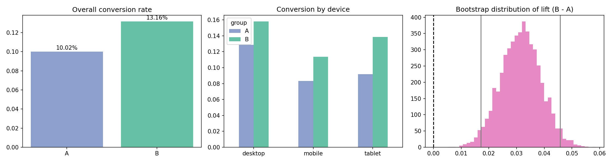

# A/B Test Analysis: Checkout Button Redesign

End-to-end statistical analysis of an A/B test comparing the current checkout button (**A**) with a redesigned one (**B**). Includes data quality checks, hypothesis testing, confidence intervals, bootstrapping, segment analysis and a business recommendation.



## Business Question
Does the new checkout button increase conversion rate and revenue per visitor?

- **H0:** Conversion rate of B = conversion rate of A
- **H1:** Conversion rate of B ≠ conversion rate of A
- **Significance level:** α = 0.05

## Methods
| Step | Technique |
|------|-----------|
| Data validation | Sample Ratio Mismatch (chi-square goodness of fit) |
| Primary metric | Two-proportion z-test on conversion rate |
| Uncertainty | 95% confidence interval + bootstrap (5,000 resamples) |
| Secondary metric | Welch's t-test on revenue per visitor |
| Segmentation | Chi-square by device with Bonferroni correction |
| Power | Observed power at measured effect size |

## Key Results
- Conversion: **10.0% (A) → 13.2% (B)**, a **+31% relative lift** (95% CI for difference: +1.7 to +4.5 pts, p < 0.001)
- Revenue per visitor rose from **$5.80 to $7.87** (p < 0.001)
- Mobile showed the clearest effect; desktop and tablet were directionally positive but not significant after Bonferroni correction
- Sample ratio check passed (p = 0.16), so randomization looks healthy

**Recommendation:** Roll out variant B, prioritising mobile, and continue monitoring desktop and tablet.

## Project Structure
```
ab-testing-project/
├── data/ab_test_data.csv      # experiment data (8,000 visitors)
├── src/generate_data.py       # creates the dataset
├── src/analysis.py            # full analysis pipeline
├── results/                   # chart + text summary
└── requirements.txt
```

## How to Run
```bash
pip install -r requirements.txt
python src/generate_data.py
python src/analysis.py
```

## Limitations
- Dataset is simulated; swap in real data with columns `user_id, group, device, converted, revenue`
- Fixed-horizon test; no sequential testing or peeking correction
- Segment results are exploratory

## Tech Stack
Python, pandas, NumPy, SciPy, Matplotlib
